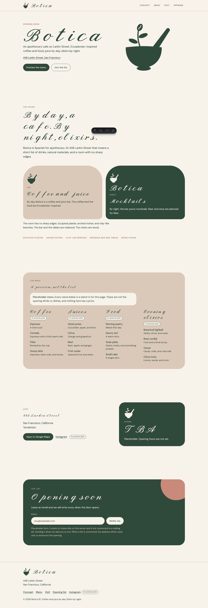

# Botica SF

One-page website for [Botica SF](https://boticasf.com), the apothecary cafe opening at 448 Larkin Street in San Francisco. It is a static site: HTML, CSS, self-hosted fonts, and images. Nothing on the page calls a third-party service.




## Develop

Node.js 22.22 or newer.

```bash
git pull origin main
npm install
npm run dev
```

Astro serves the site at [http://127.0.0.1:4321](http://127.0.0.1:4321). Production output is what you host, not the dev server.

## Build

```bash
npm run build
```

The site is written to `dist/`. That folder is the whole site. Upload it to any static host, or point a web server at it.

## Deploy on Vercel

The site is a static Astro build. `vercel.json` tells Vercel to run `npm run build` and publish `dist/`. `POST /subscribe` is still the placeholder mailing endpoint (`api/subscribe.js` returns 501).

To put it on your own Vercel account and keep it there:

```bash
npx vercel login
npx vercel --prod
```

Then add `boticasf.com` in the Vercel project’s domain settings.

## Self-host

### nginx

Copy `dist/` to the server, for example `/var/www/botica`. The `nginx.conf` in this repo is the config used by the Docker image (`root /usr/share/nginx/html`). For a normal install, use the same file and change `root` and `server_name`:

```nginx
server {
    listen 80;
    listen [::]:80;
    server_name boticasf.com www.boticasf.com;
    root /var/www/botica;
    index index.html;

    error_page 404 /404.html;

    location = /subscribe {
        default_type text/plain;
        return 501 'This signup endpoint is a placeholder.\n';
    }

    location / {
        try_files $uri $uri/ =404;
    }
}
```

Put certificates in front of this block when the domain is live (`listen 443 ssl`, or a separate TLS terminator).

### Caddy

`Caddyfile` serves the site and answers `POST /subscribe` with a placeholder 501. Set `root` to the deployed `dist/` directory.

### Docker

The image builds the site, then serves `dist/` with nginx. It listens on port 80 inside the container.

```bash
docker build -t botica-sf .
docker run --rm -p 8088:80 botica-sf
```

Open `http://127.0.0.1:8088`. The Node version in the Dockerfile is 22.23.3, which satisfies Astro’s requirement of Node 22.22 or newer.

## Replace these before opening

The page does not invent hours, prices, or a phone number.

| Item | Where it lives | What to do |
| --- | --- | --- |
| Menu | `menu` in `src/pages/index.astro` | Replace the placeholder names. Each group is labeled Placeholder. |
| Hours | Visit section, the word `TBA` | Put the real hours in when they exist. |
| Instagram | `https://www.instagram.com/boticasf` in the visit section and the footer | Point both links at the real profile. |
| Mailing list | `<form action="/subscribe">` with `data-placeholder="true"` | See below. |
| Domain in meta tags | `site` in `astro.config.mjs` | Already `https://boticasf.com`. Change it if the canonical URL differs. |

### Email signup

The form is a normal `POST` to `/subscribe`. No mailing vendor is connected.

While the form has `data-placeholder="true"`, the small script on the page stops the submit and tells the visitor that nothing was sent. When you connect a list:

1. Remove `data-placeholder="true"` from the form in `src/pages/index.astro`.
2. Point `action` at your endpoint, or keep `/subscribe` and proxy that path in nginx or Caddy.
3. Remove the placeholder `location = /subscribe` block so the request reaches your list.

Until then, a browser without JavaScript posts to `/subscribe` and receives the 501 from nginx or Caddy.

## Fonts

The Botica wordmark is the official lettering in `public/brand/botica-logo-green.svg` (on cream) and `public/brand/botica-logo-cream.svg` (on green). Those files keep the font’s original open spacing. Do not restyle them with CSS letter-spacing. Botica Relic (`public/fonts/BoticaRelic-Regular.woff2`, from `brand/BoticaRelic-Regular.otf`) is used for other display headings. DM Sans (400 and 500) is body text and labels. The fonts are self-hosted. The page does not request Google Fonts.

DM Sans is under the SIL Open Font License. The license text is in `LICENSES/`.

## Brand

| Token | Hex | Use |
| --- | --- | --- |
| Botica Beige | `#DAC8B8` | Panels, the wall color |
| Botica Green | `#2F4A3A` | Text, night, the primary logo field |
| Dusty Rose | `#C98A7A` | Accent shapes |
| Redwood | `#8F4A2B` | Small labels |
| Cream | `#F7F2EA` | Page background |

The site icon is a solid mortar, pestle, and coffee sprig, with no circle or blob behind it. `public/brand/mark-green.svg` is `#2F4A3A` for cream backgrounds. `public/brand/mark-cream.svg` is `#F7F2EA` for green backgrounds. The favicon and app icons are drawn from the green mark. The social image pairs that mark with the official green wordmark. Older blob lockups remain in `brand/` as archive files and are not used on the page.

`npm run dev` serves the site at [http://127.0.0.1:4321](http://127.0.0.1:4321).

## Layout

- `src/pages/index.astro` — the page
- `src/pages/404.astro` — missing paths
- `src/styles/global.css` — all of the CSS
- `public/` — fonts, favicon, social image, robots, sitemap
